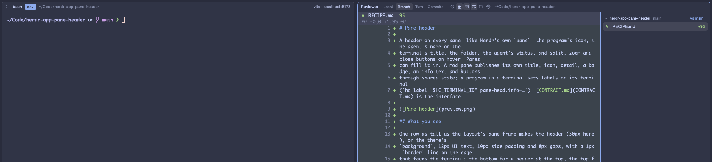

# Herdr pane header

A pane header for the [Herdr app](https://herdr.dev) that mod panes and terminal programs can fill
in. Herdr's own header, `pane`, shows each pane's program, title, folder and agent status, and
nothing a pane can change. This one shows the same, plus whatever a pane publishes: its own
title, icon, detail, a badge, an info text and buttons.



- A mod pane publishes through Herdr's shared state. The
  [reviewer](https://github.com/gfronza/herdr-app-reviewer) puts its scopes and toggles here.
- A program in a terminal sets labels on its terminal:
  `hc label "$HC_TERMINAL_ID" "pane-head.info=Opus 5.5 · high" pane-head.while=agent`.

[CONTRACT.md](CONTRACT.md) has the whole interface: what to publish, what a header promises, and
how a mod checks whether the shown layout's header draws its buttons.

## Install

Copy `mods/pane-header` into `~/.config/herdr-app/mods/`, or link it to keep a clone current:

```sh
git clone https://github.com/lucindo/herdr-app-pane-header ~/Code/herdr-app-pane-header
ln -s ~/Code/herdr-app-pane-header/mods/pane-header ~/.config/herdr-app/mods/pane-header
herdr-app check ~/.config/herdr-app/mods/pane-header
```

Then point a layout's pane frame at it. Herdr's shipped layouts are read-only, so clone one first
(`herdr-app do layout.clone '{"name":"main","as":"my-main"}'`) and give its tab block a header:

```json
{ "tab": "active",
  "pane": { "header": { "content": { "mod": "pane-header" }, "height": 30, "position": "top", "reveal": "always" } } }
```

With `"reveal": "hover"` the header shows only while the pointer is on the pane, so mods keep
their own buttons (the contract treats such a header as not drawing them).

## Based on Herdr's `pane`

`mods/pane-header/main.js` started as a copy of Herdr's stock `pane` mod as shipped in Herdr
0.1.16. Herdr is under the Apache License 2.0, like this repo ([LICENSE](LICENSE)). The split, zoom
and close icons are Herdr's, unchanged. What changed:

- It draws a pane's `pane-heads` entry and its terminal's `pane-head.*` labels (`fields.js`).
- It registers in the shared keys `pane-heads-headers` and `pane-heads-actions`.
- It loads its icons from its own folder.

## Development

```sh
npm install      # TypeScript for the type check; also points git at .githooks
scripts/check    # herdr-app check, tsc, and the tests in tests/; the pre-commit hook runs it
```

Saving a file reloads every open copy of the mod, so a linked install shows changes at once.
