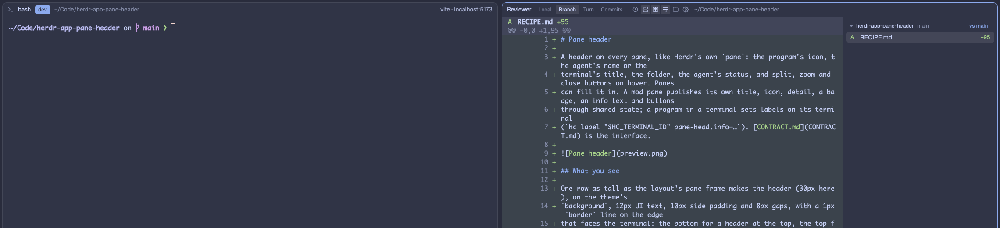

# Pane header

A header on every pane, like Herdr's own `pane`: the program's icon, the agent's name or the
terminal's title, the folder, the agent's status, and split, zoom and close buttons on hover. Panes
can fill it in. A mod pane publishes its own title, icon, detail, a badge, an info text and buttons
through shared state; a program in a terminal sets labels on its terminal
(`hc label "$HC_TERMINAL_ID" pane-head.info=…`). [CONTRACT.md](CONTRACT.md) is the interface.

## What you see

One row as tall as the layout's pane frame makes the header (30px here), on the theme's
`background`, 12px UI text, 10px side padding and 8px gaps, with a 1px `border` line on the edge
that faces the terminal: the bottom for a header at the top, the top for one at the bottom. Left
to right:

- **Icon, 14px.** The pane's published icon, tinted `dim`, or in its own colors with `color: true`;
  else the program's icon from Herdr's program table.
- **Name.** `foreground`, medium weight, at most 260px, truncated. The published title; else the
  agent's or shell's program name, the terminal's title, the program's name, or "shell".
- **Buttons** a mod pane published, 2px apart, 20px tall, rounded 4px: a 14px icon with 3px
  padding, or an 11px label with 6px padding. `dim` text; a selected one is `foreground` on
  `selected`. One with `gap` sits 8px further right.
- **Badge.** 11px, `accent_foreground` on `accent`, 6px padding, rounded 4px.
- **Detail.** `dim`, takes the rest of the width and truncates first: the published detail, else
  the pane's folder. A path in the home folder starts with `~`.
- **Info.** `muted`, kept whole: the published info, or the terminal's `pane-head.info` label.
- **Status.** While the agent works, a 12px spinner in `working` (Herdr's
  `mods/workspace-chrome/spinner.svg`, a turn every 900ms). When it's blocked, a "Needs you" pill:
  10.5px semibold `blocked` text on `blocked` at alpha `26`, 18px tall, rounded 5px. When it's
  done, a 7px `done` dot.
- **On hover,** split right, split down, zoom (unzoom when zoomed) and close: 14px icons in `dim`
  with 3px padding, rounded 4px.

Buttons and hover icons take a `hover` background and `foreground` text under the pointer; a
published button shows its tooltip.

## How it behaves

- A click on the header focuses its pane. The hover buttons run `pane.split {direction, pane}`,
  `pane.zoom {pane}` and `pane.close {pane}`.
- A published button runs `pane.focus {pane}`, then its command with its `args`. Herdr delivers a
  mod's command only to the focused copy of that mod, so the focus comes first.
- Published buttons keep their place when the hover buttons appear: the detail gives up its room.
- Each field comes from the pane's entry in the shared key `pane-heads`, else from its terminal's
  `pane-head.title`, `.detail`, `.badge` or `.info` label, else the header's own default. With
  `pane-head.while=agent` set, a terminal's labels count only while an agent reports a status
  there.
- Fields of the wrong type, and buttons without a command or without both an icon and a label, are
  left out. What another mod publishes never breaks the header.
- Herdr re-renders the header when shared state or a terminal's labels change.
- On start it registers in shared state: `pane-heads-headers["pane-header"]` =
  `{ version: 1, draws: [...] }`, and `"pane-header"` in the list `pane-heads-actions`. Mods read
  these to tell whether the shown layout's header draws their buttons.

## Built from

- A layout's tab block:
  `"pane": { "header": { "content": { "mod": "pane-header" }, "height": 30, "position": "top", "reveal": "always" } }`.
  Herdr runs one copy per pane, with `props()` = `{ pane, terminal }`.
- `mods/pane-header/main.js`: Herdr's stock `pane` mod as shipped in Herdr 0.1.16, plus the
  contract. `fields.js` holds the logic and imports nothing from Herdr: `resolve` (entry, labels
  and status → what to draw), `paneFrame` (the first visible tab block's frame, for the header's
  position), `tilde`, and the registration helpers.
- `herdr` functions: `panes()`, `terminals()` (for labels), `layout()`, `shared`, `setShared`,
  `home()`, `theme()`, `checking()`, `run()`.
- Commands: `pane.focus`, `pane.split`, `pane.zoom`, `pane.close`, and the command each published
  button names. No programs, network or files.
- Art: Herdr's `split-right`, `split-down`, `zoom`, `unzoom` and `close` SVGs, unchanged.

## Watch out

- Herdr's shipped layouts have no pane header and are read-only. Clone one (`layout.clone`) and
  give the clone's tab block the header.
- With `"reveal": "hover"` the header shows only under the pointer, so mods treat it as not drawing
  their buttons and keep their own.
- A mod pane isn't told its pane id. It finds it in `panes()` by its mod name and tab, so two
  copies of one mod in a tab can't both publish.
- `mod.clone` rewrites `mods/pane-header/` in the code, so a clone registers, and loads its icons,
  under its own name.
- Labels outlive the program that set them. An agent's labels need `pane-head.while=agent`.
- Registering writes shared state, which re-renders every mod: write only when the registration
  is missing or different, and never during `checking()`.

## Done when

- `herdr-app check` passes on `mods/pane-header`.
- With a layout's header set to `pane-header`, a shell pane looks as it does under Herdr's `pane`.
- In a shell, `hc label "$HC_TERMINAL_ID" pane-head.badge=test pane-head.info=hello` shows a `test`
  badge and a muted "hello"; adding `pane-head.while=agent` hides both.
- The reviewer (gfronza/herdr-app-reviewer) shows "Reviewer", its folder and its scope and toggle
  buttons in the header and drops its own row; clicking a scope switches it.
- Hovering shows split, zoom and close, and the published buttons don't move.
- `shared.json` has `"pane-heads-headers": { "pane-header": { "version": 1, … } }`.
